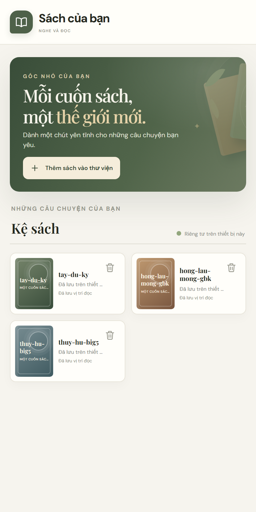
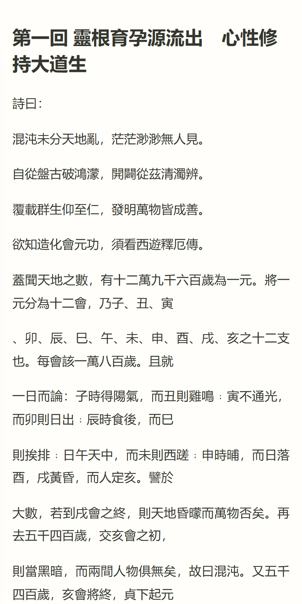
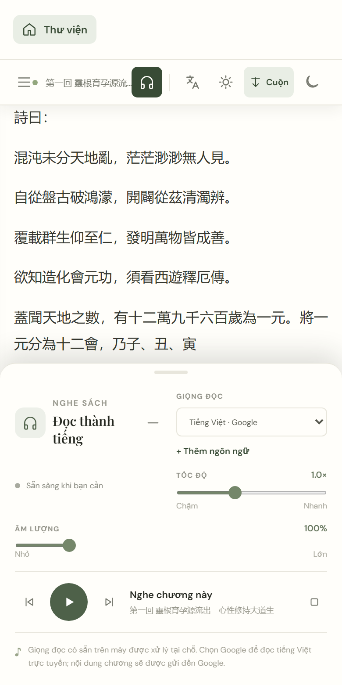
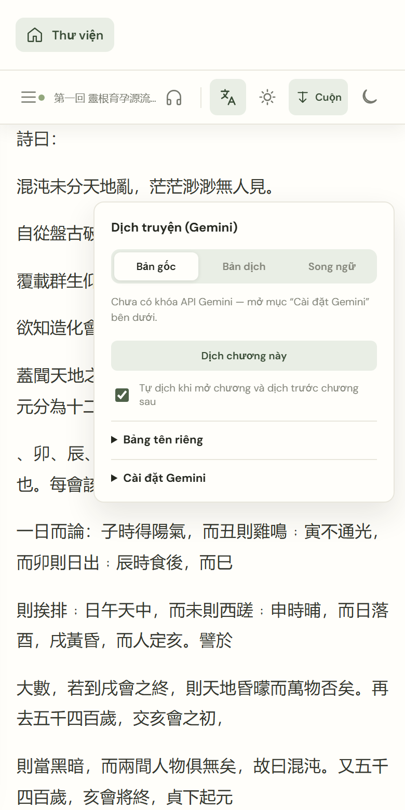

# 📖 Sách của bạn — đọc, nghe và dịch truyện ngay trên điện thoại

> Mở một cuốn sách. Đi đến một nơi khác.

**Sách của bạn** là ứng dụng đọc sách điện tử gọn nhẹ: mở file truyện có sẵn trên máy, đọc với giao diện dễ chịu, **nghe đọc thành tiếng** khi đang làm việc khác, và **dịch truyện Trung sang tiếng Việt** bằng AI với văn phong tiên hiệp, kiếm hiệp được biên tập cẩn thận.

Không cần tài khoản, không có quảng cáo, sách không bị tải lên máy chủ nào.

👉 **Dùng ngay trên trình duyệt:** https://baons183.github.io/TruyenAudio/

<p align="center">
  
  
  
  
</p>

---

## ✨ Có gì hay?

### 📚 Mở được gần như mọi file truyện
EPUB, MOBI, AZW3, PRC (Kindle không DRM), TXT, FB2, DOCX, HTML. File khác EPUB được chuyển đổi **ngay trên máy**, có mục lục và giữ lại vị trí đọc như sách EPUB.

File TXT truyện Trung cũng không làm khó app:
- Tự nhận mã hóa **UTF-8, GBK/GB18030, Big5**, và cả file tiếng Việt cũ **Windows-1258**.
- Tự chia chương theo `第一章`, `第108回`, `【第12章】`, `正文 第一百零八章`, `楔子`, `番外`, `Chương 1`, `Chapter 1`…

### 🎧 Nghe sách như nghe radio
- Đọc thành tiếng bằng **giọng có sẵn trên máy** (ví dụ giọng *Linh* trên iPhone) hoặc **giọng Google tiếng Việt**.
- **Tự sang chương tiếp theo**, có nút ⏮ ⏭ chuyển chương, chỉnh tốc độ và âm lượng.
- Bản app (iOS/Android): **nghe được khi tắt màn hình hoặc gạt im lặng**, có nút điều khiển trên màn hình khóa và thanh thông báo.

### 🌏 Dịch truyện Trung bằng Gemini
- Dịch theo từng chương bằng **khóa API Gemini của chính bạn** (có gói miễn phí).
- Prompt mặc định viết riêng cho **tiên hiệp, huyền huyễn, kiếm hiệp, cổ phong**:
  - giữ đúng tên Hán Việt, xưng hô và quan hệ nhân vật;
  - xử lý thành ngữ, điển cố (*"Tứ lạng bạt thiên cân"*, *"Họa xà thiêm túc"*…);
  - câu văn tự nhiên, nghe TTS êm tai.
- **Bộ nhớ nhân vật:** app tự lập *bảng tên riêng* qua từng chương (`张子星 → Trương Tử Tinh · nam`) để tên gọi nhất quán suốt bộ truyện. Bạn sửa được bảng này.
- Ba chế độ xem: **Bản gốc / Bản dịch / Song ngữ** (đoạn gốc kèm đoạn dịch ngay bên dưới).
- Bản dịch được lưu trên máy, **đọc lại không tốn lượt**. App tự dịch trước chương sau, đọc liền mạch.
- Giọng đọc đọc **bản dịch tiếng Việt**.

### 🎨 Đọc theo ý mình
- Chế độ **Cuộn** hoặc **Lật trang**:
  - vuốt trái/phải hoặc chạm mép màn hình để lật;
  - chạm giữa màn hình để hiện/ẩn thanh điều khiển.
- Giao diện **Sáng / Ngà / Tối**, kèm màu chữ và màu nền tự chọn.
- Chỉnh **phông chữ, cỡ chữ, khoảng cách dòng, lề hai bên**, và **độ sáng màn hình** (bản app).
- Thư viện nhớ vị trí đọc của từng cuốn. Có nút xóa sách.

### 🔒 Riêng tư
- Sách, vị trí đọc, bản dịch và cài đặt **chỉ lưu trong trình duyệt hoặc app trên máy bạn** (IndexedDB).
- App chỉ gửi nội dung ra ngoài khi bạn chủ động dùng:
  - **giọng Google:** gửi từng đoạn văn tới Google Dịch;
  - **dịch bằng Gemini:** gửi chương tới Google Gemini bằng khóa của bạn.

---

## 🚀 Bắt đầu trong 1 phút

### Cách 1: Dùng trên trình duyệt (nhanh nhất)
1. Mở **https://baons183.github.io/TruyenAudio/** trên điện thoại hoặc máy tính.
2. Bấm **Thêm sách vào thư viện** và chọn file truyện.
3. Muốn có biểu tượng như app thật:
   - **iPhone (Safari):** nút Chia sẻ → *Thêm vào MH chính*.
   - **Android (Chrome):** menu ⋮ → *Thêm vào màn hình chính*.

> Chưa có truyện để thử? Nhấn giữ một link dưới đây → *Tải về tệp được liên kết* (truyện cổ điển, không còn bản quyền, từ Project Gutenberg):
> [Tây Du Ký (UTF-8)](https://baons183.github.io/TruyenAudio/samples/tay-du-ky-utf8.txt) ·
> [Thủy Hử (Big5)](https://baons183.github.io/TruyenAudio/samples/thuy-hu-big5.txt) ·
> [Hồng Lâu Mộng (GBK)](https://baons183.github.io/TruyenAudio/samples/hong-lau-mong-gbk.txt)

### Cách 2: Cài app (bản thử nghiệm)
Bản app nghe được khi tắt màn hình, đọc được khi máy gạt im lặng, và đọc sách offline. File cài mới nhất luôn có ở mục **[Releases → Bản app mới nhất](https://github.com/baons183/TruyenAudio/releases/tag/app-latest)**:

- **Android:** tải `SachCuaBan.apk` về điện thoại, mở file và cho phép cài ứng dụng không rõ nguồn.
- **iPhone:** tải `SachCuaBan.ipa` về máy tính, rồi cài qua cáp bằng [Sideloadly](https://sideloadly.io) hoặc [AltStore](https://altstore.io) với Apple ID của bạn.
  - Cài xong, vào *Cài đặt → Cài đặt chung → Quản lý VPN & thiết bị* để **tin cậy** Apple ID đó.
  - Bật *Chế độ nhà phát triển* trong *Quyền riêng tư & Bảo mật*.
  - Với Apple ID miễn phí, app cần **cài lại sau mỗi 7 ngày**. AltStore có thể tự gia hạn qua Wi-Fi.

---

## 🌏 Dịch truyện với Gemini

1. Lấy khóa miễn phí tại **https://aistudio.google.com/apikey** → *Create API key*. Không cần thẻ.
2. Mở một cuốn truyện → bấm nút **文A** → mục **Cài đặt Gemini**:
   - dán khóa vào ô *Khóa API*;
   - bấm **Kiểm tra khóa và tải danh sách model**.
3. Chọn **Bản dịch** hoặc **Song ngữ**. Mở chương nào, chương đó được dịch.

Mẹo:
- Sửa **Bảng tên riêng** khi muốn chốt cách gọi một nhân vật hay chiêu thức. Mỗi dòng có dạng:
  ```
  张子星 = Trương Tử Tinh | nhân vật | nam | sư đệ của Hoàng Phi Hổ
  ```
- **Prompt biên tập** sửa được tùy ý, có nút khôi phục bản mặc định.
- Gói miễn phí của Gemini **giới hạn số lượt theo phút và theo ngày**. Hết lượt thì app báo rõ, chương đã dịch vẫn đọc bình thường. Với gói miễn phí, Google có thể dùng nội dung gửi lên để cải thiện sản phẩm.

---

## 🧭 Web và app khác nhau thế nào?

| | Trình duyệt | App iOS/Android |
|---|---|---|
| Đọc, dịch, đổi giao diện | ✅ | ✅ |
| Giọng đọc trên máy (Linh…) | ✅ (iPhone: tắt khi gạt im lặng hoặc khóa màn hình) | ✅ cả khi im lặng và khóa màn hình |
| Giọng Google | ✅ | ✅ |
| Nghe khi tắt màn hình | Chỉ với giọng Google | ✅ |
| Nút điều khiển trên màn hình khóa | Có phần hạn chế | ✅ |
| Chỉnh độ sáng màn hình | — | ✅ |
| Cần cài đặt | Không | Có (APK / IPA) |

---

## ⚠️ Hạn chế hiện tại

- **Sách có DRM** (mua từ Kindle, Google Play Sách…) không mở được. App chỉ đọc file không khóa bản quyền.
- **PDF** chưa được hỗ trợ.
- **Giọng Google** dùng cổng không chính thức của Google Dịch, nên có thể ngừng hoạt động bất cứ lúc nào. Khi đó hãy dùng giọng có sẵn trên máy.
- File TXT **thiếu dòng tiêu đề chương** sẽ được chia theo độ dài (khoảng 15.000–40.000 ký tự một phần), không khớp chương thật.
- Ở chế độ Bản dịch / Song ngữ, vị trí đọc đã lưu có thể lệch nhẹ trong chương.
- Bản app iOS hiện chỉ cài được kiểu "sideload", chưa có trên App Store.

Gặp lỗi hay có ý tưởng? Hãy mở một [Issue](https://github.com/baons183/TruyenAudio/issues).

---

## 🛠️ Dành cho nhà phát triển

Ứng dụng web viết bằng **HTML/CSS/JavaScript thuần**: không framework, không bước build cho bản web. Bản app đóng gói bằng **Capacitor**, kèm một plugin native nhỏ cho giọng đọc.

```
index.html, styles.css, app.js   Giao diện và logic chính (thư viện, trình đọc, giọng đọc)
converters.js                    Chuyển TXT / MOBI / AZW3 / FB2 / DOCX / HTML → EPUB ngay trên máy
translator.js                    Dịch chương bằng Gemini API, prompt mặc định, bảng tên riêng
vendor/                          foliate-js (giải mã MOBI/KF8)
native/reader-speech/            Plugin Capacitor: AVSpeechSynthesizer (iOS), TextToSpeech + dịch vụ nền (Android)
scripts/build-www.mjs            Tạo thư mục www/ cho app, đóng gói thư viện để chạy offline
.github/workflows/build-apps.yml Tự build IPA (chưa ký) và APK, đăng vào Release "app-latest"
samples/                         Truyện mẫu để thử nhập TXT
```

**Chạy bản web trên máy:**
```bash
python -m http.server 8000
# mở http://localhost:8000
```

**Build app:** mỗi lần push lên `main`, GitHub Actions tự build và cập nhật [Release "app-latest"](https://github.com/baons183/TruyenAudio/releases/tag/app-latest). Muốn build thủ công thì cần Node 22+:
```bash
npm install
npm run build              # tạo www/
npx cap add android        # hoặc: npx cap add ios --packagemanager SPM (cần macOS + Xcode)
npx cap sync
```

---

## 🙏 Ghi công

- [epub.js](https://github.com/futurepress/epub.js): hiển thị EPUB (BSD-2-Clause)
- [JSZip](https://stuk.github.io/jszip/): đọc và tạo file ZIP/EPUB (MIT hoặc GPLv3)
- [foliate-js](https://github.com/johnfactotum/foliate-js): giải mã MOBI/AZW3 (MIT, xem `vendor/foliate-js-LICENSE.txt`)
- [Capacitor](https://capacitorjs.com): đóng gói app iOS/Android (MIT)
- [Project Gutenberg](https://www.gutenberg.org): truyện mẫu trong `samples/`, thuộc phạm vi công cộng tại Hoa Kỳ, giữ nguyên phần giấy phép Gutenberg trong file

---

<p align="center"><i>Chúc bạn những giờ đọc và nghe thật thư thái. 🍃</i></p>
